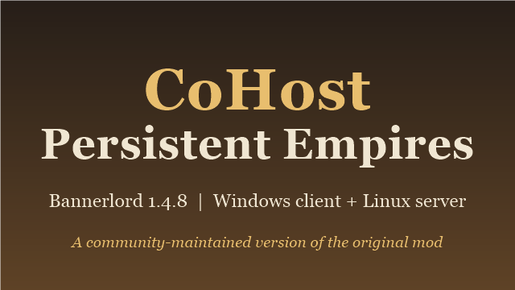

# CoHost Persistent Empires

A multiplayer roleplay and strategy mod for **Mount & Blade II: Bannerlord 1.4.8**. You join a persistent medieval world on a
community server, pick a class, and play alongside everyone else: gather, craft, trade, build, form factions and fight wars.

**[Download the latest release](../../releases/latest)** · [Discord](https://discord.gg/X3g7GrBZjv) · [Installation](#installation)

## How it works

You play on a server that is always running. Your character, gold, inventory and faction are saved, so you come back to the same
world each time. Join from **Multiplayer > Custom Server List**, wait for your character to appear, and press **F** to spawn.

- **Classes.** Pick a class to set how you start and what you can do; classes can be customised further.
- **Factions and diplomacy.** Players form factions with a lord, declare wars, and fight field battles and sieges. A faction elects
  its lord with a poll: press the **accept** or **decline** key shown on screen to vote.
- **Player-led economy.** Shops, stockpile markets and trading centres are run by players. Store screens show the live stock and
  update as items are bought and sold.
- **Gathering and crafting.** Collect resources, then turn them into goods at crafting stations and machines.
- **Building and destruction.** Upgrade buildings, and tear structures down in sieges and raids.
- **Wounding (when the server enables it).** Wounded players move slowly and are limited in what they can fight with until the timer
  runs out or a medic heals them. A red **WOUNDED** indicator on your status panel shows when it applies.
- **Roleplay options.** Optional immersion systems (such as voice chat, instruments and colour changes) that servers can turn on.

Each server decides its own rules, so details such as wounding time or prices vary from server to server.

## Installation

You need Windows, Bannerlord **1.4.8** (the public branch) and the original **Persistent Empires** Workshop item. This mod uses
that item's game assets and installs next to it as a separate module.

**Using the Steam Workshop version?** Then you do not need any of this: Steam installs and updates it. This is for the GitHub
download. If you have both, keep one (the setup file warns you).

1. Close Bannerlord. Download `CoHostPersistentEmpires-<version>.zip` from the [latest release](../../releases/latest), right-click it
   and choose **Extract All**.
2. Double-click **CoHost PE Mod Installer.bat**. It shows what it found on your PC: Steam, Bannerlord, the original Persistent Empires (subscribe
   to it on the Steam Workshop if it is missing: [Persistent Empires](https://steamcommunity.com/sharedfiles/filedetails/?id=2937242207)),
   and any existing CoHost install. It then tells you what to do next.
3. Choose **1 Install**. It shows which folders it will create, copy and link, and asks before it changes anything.
4. In the launcher choose **Multiplayer** and tick **Native**, **Multiplayer** and **CoHost Persistent Empires** (not the original).
   Start the game, open the custom server list and join a server running this mod.

Servers running this mod only accept this version, and servers running the original only accept the original.

### Updating, checking and removing

Run **CoHost PE Mod Installer.bat** again and choose **2 Update** (lists the files that changed, usually a few MB, asks, and checks each download
against the release's SHA-256 list), **3 Check** (finds and explains problems) or **4 Uninstall** (the original mod's files are never
touched).

If a server refuses you with *"Not all players' modules match"*, you are on a different version from the server: update, or ask
the server owner which version it runs.

### What the installer does

It builds `Modules\CoHostPersistentEmpires` in your Bannerlord folder from this download (code, screens, text; about 13 MB) and the
original mod's files on your PC: its `ModuleData` and `GUI` are copied and its large asset folders are linked, so there is no extra disk
space. It does not change the original mod or Bannerlord's own files, does not need administrator rights, and the installer does not use
the internet (the updater only talks to this project's GitHub releases). `CoHost PE Mod Installer.bat` is plain text, so open it in Notepad to read
every step; it only starts the PowerShell files in `scripts` once you choose an option, with the script policy bypassed for that single
run. Windows may warn about files from the internet: right-click the zip, **Properties**, **Unblock**, then extract it. The SHA-256 of
each zip is in its release notes. Details: [PLAYERS.md](PLAYERS.md).

## Reporting problems

Join the [Discord](https://discord.gg/X3g7GrBZjv). For a crash or an error message, attach
`%ProgramData%\Mount and Blade II Bannerlord\logs\CoHostPE_exceptions.txt`.

## Source and licence

The client and shared-library source are in this repository. Licensed under **AGPL-3.0** (`LICENCE.md`).

Based on [Persistent Empires](https://github.com/AR-Development/PersistentEmpires-OpenSourced) by AR-Development and contributors,
who handed the mod over for community maintenance. Game assets belong to their authors and are not part of this repository; third-party
credits are in `Credits.txt` inside the module. This version is maintained by Davwado and [Coalition Hosting](https://cohost.au).
